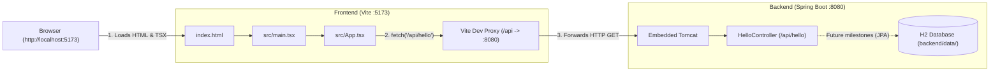
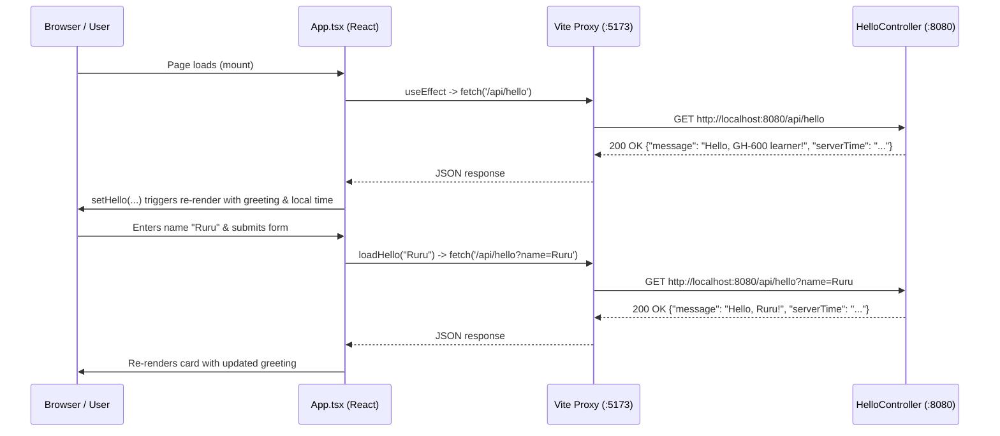

# Codebase Structure & Program Files Guide

This document provides a complete architectural overview and file-by-file breakdown of the **GH-600 Study App** (`backend/` and `frontend/`).

---

## 1. High-Level Architecture & Request Flow

During local development, two servers run side by side:
1. **Frontend Dev Server (Vite on `:5173`)**: Serves `index.html`, compiles TypeScript/JSX on the fly, and proxies any `/api/*` request to `:8080`.
2. **Backend API Server (Spring Boot / Embedded Tomcat on `:8080`)**: Handles `/api/*` REST requests, serializes Java records to JSON via Jackson, and connects to a file-based H2 database (`backend/data/gh600`).



### End-to-End Request Sequence



---

## 2. Repository Directory Layout

```text
gh600/
├── start.ps1 / start.cmd                 # Root startup scripts (launches both servers)
├── backend/                              # Spring Boot 4.1.1 (Java 25, Maven)
│   ├── pom.xml                           # Maven build configuration & dependencies
│   ├── mvnw / mvnw.cmd                   # Maven Wrapper scripts (no global Maven install needed)
│   ├── data/                             # On-disk H2 database files (gitignored)
│   └── src/
│       ├── main/
│       │   ├── java/com/gh600/study/
│       │   │   ├── BackendApplication.java   # @SpringBootApplication entry point
│       │   │   ├── HelloController.java      # REST controller for GET /api/hello
│       │   │   └── question/                 # Milestones 1–2: Question domain, persistence & REST API
│       │   │       ├── Domain.java           # Enum of the 6 GH-600 exam domains
│       │   │       ├── Question.java         # @Entity for practice questions (@OneToMany options)
│       │   │       ├── AnswerOption.java     # @Entity for answer choices (@ManyToOne question)
│       │   │       ├── QuestionRepository.java # Spring Data JpaRepository + @Query JOIN FETCH
│       │   │       ├── QuestionDataSeeder.java # CommandLineRunner seeding 3 sample questions
│       │   │       ├── QuestionDto.java      # Outbound DTO record for Question
│       │   │       ├── AnswerOptionDto.java  # Outbound DTO record for AnswerOption
│       │   │       ├── CreateQuestionRequest.java      # Inbound @Valid request record for Question
│       │   │       ├── CreateAnswerOptionRequest.java  # Inbound @Valid request record for AnswerOption
│       │   │       ├── QuestionService.java  # @Service & @Transactional business logic
│       │   │       ├── QuestionController.java # @RestController for /api/questions CRUD
│       │   │       ├── NotFoundException.java # 404 domain exception
│       │   │       └── ApiExceptionHandler.java # @RestControllerAdvice returning RFC 9457 ProblemDetail
│       │   └── resources/
│       │       └── application.properties    # Port, H2 datasource, and JPA/Hibernate settings
│       └── test/
│           ├── java/com/gh600/study/
│           │   ├── BackendApplicationTests.java  # Full-context smoke test (@SpringBootTest)
│           │   ├── HelloControllerTest.java      # Web-slice unit test (@WebMvcTest + MockMvc)
│           │   └── question/
│           │       ├── QuestionRepositoryTest.java # JPA slice test (@DataJpaTest)
│           │       └── QuestionControllerTest.java # Web-slice test (@WebMvcTest + @MockitoBean)
│           └── resources/
│               └── application.properties    # In-memory H2 config for test isolation
├── frontend/                             # React 19 + TypeScript ~6.0 + Vite 8.3
│   ├── package.json                      # Dependencies & npm scripts (dev, build, lint, preview)
│   ├── vite.config.ts                    # Vite port (5173), React plugin, and /api proxy to :8080
│   ├── tsconfig.json                     # Root TypeScript solution config referencing app & node configs
│   ├── tsconfig.app.json                 # TypeScript compiler settings for browser code in src/
│   ├── tsconfig.node.json                # TypeScript compiler settings for vite.config.ts
│   ├── .oxlintrc.json                    # Oxlint linter rules for React & TypeScript
│   ├── index.html                        # Single-page HTML shell mounting /src/main.tsx
│   └── src/
│       ├── main.tsx                      # React DOM entry point (mounts <App /> in <StrictMode>)
│       ├── App.tsx                       # Root <BrowserRouter> & <Routes> (/questions, /questions/:id)
│       ├── App.css                       # Styles for Layout, nav, filter bar, cards & detail page
│       ├── index.css                     # Global CSS variables, light/dark theme, typography
│       ├── types/
│       │   └── question.ts               # Domain, Question, AnswerOption TypeScript types & DOMAINS list
│       ├── hooks/
│       │   ├── useQuestions.ts           # Custom hook fetching /api/questions with AbortController
│       │   └── useQuestion.ts            # Custom hook fetching /api/questions/:id with 404 detection
│       ├── pages/
│       │   ├── QuestionsPage.tsx         # /questions route page (URL search params + list)
│       │   └── QuestionDetailPage.tsx    # /questions/:id route page (Prev/Next + 404 card)
│       └── components/
│           ├── Layout.tsx                # Shared header, NavLinks, /api/hello bar & <Outlet />
│           ├── DomainFilter.tsx          # Controlled domain dropdown & question count badge
│           ├── QuestionList.tsx          # Renders loading/error/empty states or QuestionCard list
│           └── QuestionCard.tsx          # Interactive question card with answer/explanation reveal
├── docs/                                 # Project documentation, study guide, and parsed GH-600 exams
```

---

## 3. Backend Structure & Program Files (`backend/`)

The backend is a **Spring Boot 4.1.1** application targeting **Java 25** and built with **Maven**.

### Build & Configuration Files

| File | Role & Key Details |
|------|--------------------|
| [backend/pom.xml](../backend/pom.xml) | Defines the parent POM (`spring-boot-starter-parent` `4.1.1`), `<java.version>25</java.version>`, and dependencies:<br>• `spring-boot-starter-webmvc`: Embedded Tomcat server, Spring MVC routing, and Jackson JSON converter.<br>• `spring-boot-starter-data-jpa` & `com.h2database:h2`: Hibernate ORM + embedded H2 relational database.<br>• `spring-boot-starter-validation`: Bean validation (`jakarta.validation`).<br>• `spring-boot-h2console` & `spring-boot-devtools`: Browser DB console (`/h2-console`) and automatic hot-restart during development.<br>• `*-test` starters: JUnit 5, `MockMvc`, and Spring test context support. |
| [backend/mvnw.cmd](../backend/mvnw.cmd) & [backend/mvnw](../backend/mvnw) | Maven Wrapper scripts (configured in `.mvn/wrapper/maven-wrapper.properties`). They download and run the exact Maven version required by the project without needing Maven installed globally. |
| [backend/src/main/resources/application.properties](../backend/src/main/resources/application.properties) | Central Spring Boot configuration:<br>• `server.port=8080`: Runs embedded Tomcat on port 8080.<br>• `spring.datasource.url=jdbc:h2:file:./data/gh600`: Stores H2 database tables in `backend/data/gh600.mv.db` so data persists across restarts.<br>• `spring.h2.console.enabled=true`: Exposes the interactive SQL console at `http://localhost:8080/h2-console`.<br>• `spring.jpa.hibernate.ddl-auto=update`: Automatically creates/updates database tables from `@Entity` classes.<br>• `spring.jpa.show-sql=true` & `format_sql=true`: Prints formatted SQL queries to the console. |

### Java Source Files (`src/main/java/com/gh600/study/`)

1. **[BackendApplication.java](../backend/src/main/java/com/gh600/study/BackendApplication.java)**
   - Annotated with `@SpringBootApplication`, which combines:
     - `@SpringBootConfiguration`: Marks the class as a source of bean definitions.
     - `@EnableAutoConfiguration`: Automatically configures Tomcat, Jackson, Hibernate, and H2 based on the jars in `pom.xml`.
     - `@ComponentScan`: Scans `com.gh600.study` and all sub-packages for `@RestController`, `@Service`, `@Repository`, and `@Component` classes.
   - `main(String[] args)` calls `SpringApplication.run(BackendApplication.class, args)` to boot the application context and start Tomcat on port `8080`.

2. **[HelloController.java](../backend/src/main/java/com/gh600/study/HelloController.java)**
   - Annotated with `@RestController` (`@Controller` + `@ResponseBody`) and `@RequestMapping("/api")`.
   - Defines an immutable Java `record`:
     ```java
     public record HelloResponse(String message, Instant serverTime) {}
     ```
     Jackson automatically serializes this record into JSON: `{"message": "...", "serverTime": "2026-...Z"}`.
   - Exposes `GET /api/hello`:
     ```java
     @GetMapping("/hello")
     public HelloResponse hello(@RequestParam(defaultValue = "GH-600 learner") String name)
     ```
     Binds the optional `?name=` query parameter (defaulting to `"GH-600 learner"`) and returns a `HelloResponse` with `Instant.now()`.

3. **Question Domain & Persistence (`src/main/java/com/gh600/study/question/`)**
   - **[Domain.java](../backend/src/main/java/com/gh600/study/question/Domain.java)**: Enum of the 6 GH-600 exam domains with human-readable titles.
   - **[Question.java](../backend/src/main/java/com/gh600/study/question/Question.java)**: `@Entity` mapped to the `question` table (`id`, `text`, `domain` stored as `EnumType.STRING`, `explanation`, `multiSelect`, and `@OneToMany(mappedBy = "question", cascade = CascadeType.ALL, orphanRemoval = true)` for `options`).
   - **[AnswerOption.java](../backend/src/main/java/com/gh600/study/question/AnswerOption.java)**: `@Entity` mapped to `answer_option`, owning the `question_id` foreign key via `@ManyToOne(fetch = FetchType.LAZY) @JoinColumn(name = "question_id")`.
   - **[QuestionRepository.java](../backend/src/main/java/com/gh600/study/question/QuestionRepository.java)**: Extends `JpaRepository<Question, Long>` with derived queries (`findByDomain`, `findByMultiSelectTrue`) and `@Query` methods using `LEFT JOIN FETCH` (`findAllWithOptions`, `findByDomainWithOptions`) to prevent N+1 queries.
   - **[QuestionDataSeeder.java](../backend/src/main/java/com/gh600/study/question/QuestionDataSeeder.java)**: `@Component` implementing `CommandLineRunner` that seeds 3 sample GH-600 questions at startup when `questionRepository.count() == 0`.

### Java Test Files (`src/test/java/com/gh600/study/`)

1. **[BackendApplicationTests.java](../backend/src/test/java/com/gh600/study/BackendApplicationTests.java)**
   - Annotated with `@SpringBootTest`.
   - Starts the full Spring application context (using the in-memory H2 config in [src/test/resources/application.properties](../backend/src/test/resources/application.properties)) and verifies that `QuestionDataSeeder` seeds the sample questions.

2. **[HelloControllerTest.java](../backend/src/test/java/com/gh600/study/HelloControllerTest.java)**
   - Annotated with `@WebMvcTest(HelloController.class)`.
   - Loads **only** the web layer (`HelloController` and Jackson serialization) without starting Tomcat or H2, making it very fast.
   - Injects `MockMvc` to simulate `GET /api/hello` (with and without `?name=Ruru`) and asserts HTTP `200 OK` and the JSON response path `$.message`.

3. **[QuestionRepositoryTest.java](../backend/src/test/java/com/gh600/study/question/QuestionRepositoryTest.java)**
   - Annotated with `@DataJpaTest`.
   - Tests saving a `Question` with cascaded `AnswerOption`s, `orphanRemoval`, derived queries (`findByDomain`, `findByMultiSelectTrue`), and `LEFT JOIN FETCH` queries.

---

## 4. Frontend Structure & Program Files (`frontend/`)

The frontend is a **React 19** single-page application written in **TypeScript** and bundled with **Vite 8**.

### Build, Tooling & Configuration Files

| File | Role & Key Details |
|------|--------------------|
| [frontend/package.json](../frontend/package.json) | Declares runtime dependencies (`react`, `react-dom` `^19.2.8`) and dev tooling (`vite`, `@vitejs/plugin-react`, `typescript`, `oxlint`).<br>Scripts:<br>• `npm run dev`: Starts Vite dev server on `:5173`.<br>• `npm run build`: Runs `tsc -b` (type-checking) followed by `vite build` (outputs production bundle to `dist/`).<br>• `npm run lint`: Runs `oxlint` for fast static analysis.<br>• `npm run preview`: Previews the production build locally. |
| [frontend/vite.config.ts](../frontend/vite.config.ts) | Configures the Vite server on port `5173`, enables `@vitejs/plugin-react` for Fast Refresh (HMR), and configures the development proxy:<br>`proxy: { '/api': 'http://localhost:8080' }`<br>Because the browser sends requests to `http://localhost:5173/api/...`, it stays on the same origin and avoids CORS issues during development. |
| [frontend/tsconfig.json](../frontend/tsconfig.json), [tsconfig.app.json](../frontend/tsconfig.app.json), [tsconfig.node.json](../frontend/tsconfig.node.json) | Split TypeScript configuration:<br>• `tsconfig.app.json`: Type-checks browser code in `src/` (`DOM` + `ES2023` libs, `react-jsx`, strict unused checks).<br>• `tsconfig.node.json`: Type-checks Node-side config (`vite.config.ts`). |
| [frontend/.oxlintrc.json](../frontend/.oxlintrc.json) | Configures Oxlint plugins (`react`, `typescript`, `oxc`) and enforces `react/rules-of-hooks` (`error`) and `react/only-export-components` (`warn`). |

### Application Source Files (`index.html` & `src/`)

1. **[frontend/index.html](../frontend/index.html)**
   - The HTML entry point served by Vite.
   - Contains `<div id="root"></div>` where React mounts the UI, and `<script type="module" src="/src/main.tsx"></script>` which loads the TypeScript entry point.

2. **[frontend/src/main.tsx](../frontend/src/main.tsx)**
   - Calls `createRoot(document.getElementById('root')!).render(...)`.
   - Imports global styles (`./index.css`) and renders `<App />` inside `<StrictMode>`.
   - Note: `<StrictMode>` intentionally double-invokes `useEffect` in development mode to help catch impure side effects, which is why you see two initial `GET /api/hello` calls in DevTools.

3. **[frontend/src/App.tsx](../frontend/src/App.tsx)**
   - **Data Contract (`HelloResponse`):**
     ```ts
     type HelloResponse = {
       message: string
       serverTime: string
     }
     ```
     Mirrors `HelloController.HelloResponse` on the backend.
   - **Component State (`useState`):**
     - `hello`: Stores the latest `HelloResponse | null` from the backend.
     - `error`: Stores an error message string (`string | null`) if the fetch fails or returns a non-2xx HTTP status.
     - `name`: Controlled `<input>` state holding the user's typed name.
   - **Network Helper (`loadHello(who?: string)`):**
     - Resets `error` to `null`, builds the query string (`?name=...` using `encodeURIComponent`), calls `fetch('/api/hello...')`, checks `res.ok`, and updates `hello` with `await res.json()` (or sets `error` in the `catch` block).
   - **Initial Load (`useEffect`):**
     - Runs `loadHello()` once when `<App />` mounts (`[]` dependency array).
   - **Rendered UI (JSX):**
     - Conditionally renders an error banner (`{error && ...}`), a loading indicator (`{!hello && !error && ...}`), or the greeting card (`{hello && ...}`) showing `hello.message` and `new Date(hello.serverTime).toLocaleString()`.
     - Renders a controlled `<form>` with `<input value={name} onChange={...} />` and a submit button that calls `e.preventDefault()` and `loadHello(name)`.

4. **[frontend/src/App.css](../frontend/src/App.css) & [frontend/src/index.css](../frontend/src/index.css)**
   - `index.css`: Defines root CSS custom properties (light & dark mode palettes via `@media (prefers-color-scheme: dark)`), responsive typography (`h1`, `h2`, `code`), and the `#root` flex container.
   - `App.css`: Styles the `.app` container (`max-width: 560px`), `.card` box, `.message`, `.time`, `.error` text, and the horizontal `form` layout.

---

## 5. How Backend and Frontend Stay in Sync

When adding new features (such as Milestone 1–9 in [study-guide.md](study-guide.md)), changes follow a predictable full-stack pattern:

| Layer | Backend (`backend/src/main/java/com/gh600/study/`) | Frontend (`frontend/src/`) |
|-------|----------------------------------------------------|----------------------------|
| **Route / URL** | `@RequestMapping("/api/...")` on `@RestController` | `fetch('/api/...')` (forwarded by `vite.config.ts` proxy) |
| **Data Shape (DTO)** | Java `record` (e.g., `HelloResponse`) serialized by Jackson | TypeScript `type` / `interface` (e.g., `type HelloResponse`) |
| **Database** | `@Entity` class + `JpaRepository` interface + H2 (`./data/gh600`) | Displayed & mutated via React state (`useState` / `useEffect`) |
| **Tests** | `@WebMvcTest` (controller slice) & `@SpringBootTest` | Type-check (`npm run build`) & lint (`npm run lint`) |

