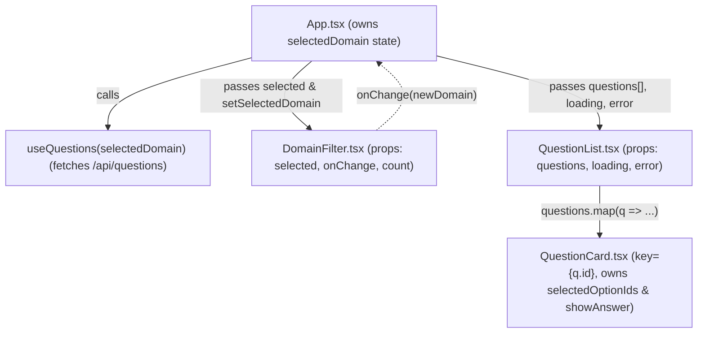

# Question List Page (Milestone 3)

**Types:** [frontend/src/types/question.ts](../frontend/src/types/question.ts)
**Custom Hook:** [frontend/src/hooks/useQuestions.ts](../frontend/src/hooks/useQuestions.ts)
**Components:** [DomainFilter.tsx](../frontend/src/components/DomainFilter.tsx), [QuestionList.tsx](../frontend/src/components/QuestionList.tsx), [QuestionCard.tsx](../frontend/src/components/QuestionCard.tsx)
**Root Component:** [frontend/src/App.tsx](../frontend/src/App.tsx)

The React UI for browsing, filtering, and practicing GH-600 questions fetched from `GET /api/questions`.

---

## Component Hierarchy & Data Flow

---

## Key React Concepts Demonstrated

| Concept | File | How it works |
|---------|------|--------------|
| **Splitting into components & Props** | `App.tsx`, `DomainFilter.tsx`, `QuestionList.tsx`, `QuestionCard.tsx` | `App` coordinates top-level state and passes data down to focused child components via typed `props`. |
| **Lifting State Up** | `App.tsx` ↔ `DomainFilter.tsx` | `selectedDomain` lives in `App` because both `DomainFilter` (the dropdown) and `useQuestions` (the data fetcher) need it. `DomainFilter` notifies `App` via `onChange`. |
| **Custom Hook (`useQuestions`)** | `hooks/useQuestions.ts` | Extracts `questions`, `loading`, and `error` state + `useEffect` fetch logic out of `App.tsx` into a reusable function starting with `use`. |
| **Effect Dependencies & `AbortController`** | `hooks/useQuestions.ts` | `[domain]` in `useEffect(..., [domain])` triggers a re-fetch whenever the filter changes. Returning `() => controller.abort()` cancels stale in-flight requests if the user switches filters rapidly. |
| **List Rendering (`.map()`) & `key={q.id}`** | `QuestionList.tsx` | Renders a `<QuestionCard>` per question using the database primary key `q.id` as `key`. Using `q.id` instead of the array index ensures React resets or preserves each card's local `showAnswer` state accurately when filtering. |
| **Local Component State** | `QuestionCard.tsx` | Each card manages its own `selectedOptionIds` and `showAnswer` toggle so interacting with one question does not affect other cards on the page. |

