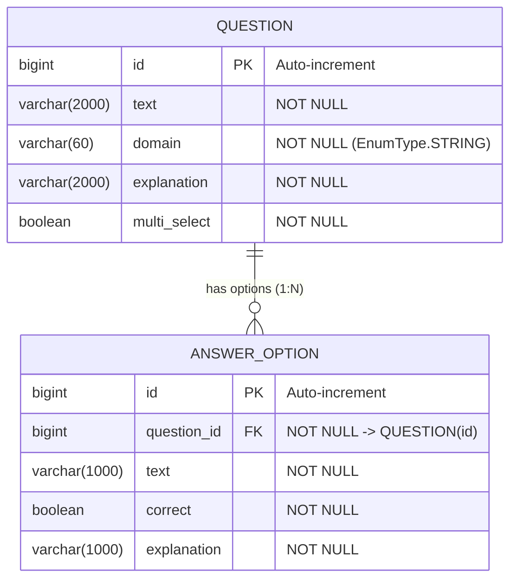

# Question Model & Database (Milestone 1)

**Package:** `com.gh600.study.question`
**Entities:** [Question.java](../backend/src/main/java/com/gh600/study/question/Question.java), [AnswerOption.java](../backend/src/main/java/com/gh600/study/question/AnswerOption.java), [Domain.java](../backend/src/main/java/com/gh600/study/question/Domain.java)
**Repository:** [QuestionRepository.java](../backend/src/main/java/com/gh600/study/question/QuestionRepository.java)
**Seeder:** [QuestionDataSeeder.java](../backend/src/main/java/com/gh600/study/question/QuestionDataSeeder.java)
**Tests:** [QuestionRepositoryTest.java](../backend/src/test/java/com/gh600/study/question/QuestionRepositoryTest.java)

Stores GH-600 practice questions and their answer options in the file-based H2 database using Spring Data JPA / Hibernate.

---

## Database Schema (Entity-Relationship)

With `spring.jpa.hibernate.ddl-auto=update`, Hibernate automatically creates two tables from our `@Entity` classes:



---

## Key JPA Concepts Used

| Concept | File | How it works |
|---------|------|--------------|
| `@Entity` + `@Id` + `@GeneratedValue(IDENTITY)` | `Question.java`, `AnswerOption.java` | Maps the Java class to a table (`question`, `answer_option`) with an auto-incrementing `BIGINT` primary key. |
| `@Enumerated(EnumType.STRING)` | `Question.domain` ([Domain.java](../backend/src/main/java/com/gh600/study/question/Domain.java)) | Stores the enum name (e.g., `"AGENT_ARCHITECTURE_AND_SDLC"`) instead of its numeric index (`0`, `1`, ...). Reordering enum values won't corrupt existing rows. |
| Bidirectional `@OneToMany` / `@ManyToOne` | `Question.options` ↔ `AnswerOption.question` | `AnswerOption` is the **owning side** because its table holds the `question_id` foreign key (`@JoinColumn(name = "question_id")`). `Question.options` sets `mappedBy = "question"` and uses `Question.addOption(...)` to keep both references in sync. |
| `cascade = CascadeType.ALL` & `orphanRemoval = true` | `Question.options` | Saving/deleting a `Question` automatically saves/deletes its `AnswerOption`s. Removing an option from `question.getOptions()` deletes its row in `answer_option`. |
| Lazy loading & `JOIN FETCH` (N+1 fix) | `AnswerOption.question` (`LAZY`), `QuestionRepository` | `@OneToMany` is `LAZY` by default; `@ManyToOne` is explicitly set to `FetchType.LAZY`. When options are needed up front, `findAllWithOptions()` uses `LEFT JOIN FETCH q.options` to load questions + options in **1 SQL query** instead of `1 + N`. |
| `CommandLineRunner` seeding | `QuestionDataSeeder.java` | Runs at startup and seeds 3 GH-600 sample questions if `questionRepository.count() == 0`. |

---

## Inspecting in the H2 Console

1. Start the backend (`.\start.ps1` or `cd backend; .\mvnw.cmd spring-boot:run`).
2. Open **http://localhost:8080/h2-console**:
   - **JDBC URL:** `jdbc:h2:file:./data/gh600`
   - **User Name:** `sa`
   - **Password:** *(leave empty)*
3. Run queries:

```sql
-- View seeded questions
SELECT id, domain, multi_select, text FROM question;

-- View questions joined with their options
SELECT q.id AS q_id, q.domain, o.id AS opt_id, o.correct, o.text
FROM question q
JOIN answer_option o ON o.question_id = q.id
ORDER BY q.id, o.id;
```

---

## Running the Repository Tests

```powershell
cd backend
.\mvnw.cmd test -Dtest=QuestionRepositoryTest
```

