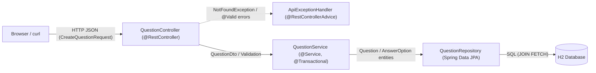

# Questions REST API — `/api/questions` (Milestone 2)

**Controller:** [QuestionController.java](../backend/src/main/java/com/gh600/study/question/QuestionController.java)
**Service:** [QuestionService.java](../backend/src/main/java/com/gh600/study/question/QuestionService.java)
**DTOs:** [QuestionDto.java](../backend/src/main/java/com/gh600/study/question/QuestionDto.java), [AnswerOptionDto.java](../backend/src/main/java/com/gh600/study/question/AnswerOptionDto.java), [CreateQuestionRequest.java](../backend/src/main/java/com/gh600/study/question/CreateQuestionRequest.java), [CreateAnswerOptionRequest.java](../backend/src/main/java/com/gh600/study/question/CreateAnswerOptionRequest.java)
**Error handling:** [NotFoundException.java](../backend/src/main/java/com/gh600/study/question/NotFoundException.java), [ApiExceptionHandler.java](../backend/src/main/java/com/gh600/study/question/ApiExceptionHandler.java)
**Tests:** [QuestionControllerTest.java](../backend/src/test/java/com/gh600/study/question/QuestionControllerTest.java)

A full CRUD REST API for GH-600 study questions, using layered architecture (`Controller -> Service -> Repository`), Java record DTOs, Jakarta Bean Validation, and RFC 9457 `ProblemDetail` error responses.

---

## Architecture Layers



---

## Endpoints

| Method | Path | Success Status | Description |
|--------|------|----------------|-------------|
| `GET` | `/api/questions[?domain=<Domain>]` | `200 OK` | List all questions (or filter by one of the 6 `Domain` enum values) |
| `GET` | `/api/questions/{id}` | `200 OK` | Get one question by ID (`404 Not Found` if missing) |
| `POST` | `/api/questions` | `201 Created` | Create a new question + options (validates `@Valid` request body; returns `Location` header) |
| `PUT` | `/api/questions/{id}` | `200 OK` | Replace an existing question's fields and options (`404` if missing) |
| `DELETE` | `/api/questions/{id}` | `204 No Content` | Delete a question and its options (`404` if missing) |

---

## Try It with PowerShell / `curl`

### 1. List all seeded questions
```powershell
curl.exe http://localhost:8080/api/questions
```

### 2. Filter by domain
```powershell
curl.exe "http://localhost:8080/api/questions?domain=GUARDRAILS_AND_ACCOUNTABILITY"
```

### 3. Get one question by ID (and test 404)
```powershell
curl.exe http://localhost:8080/api/questions/1
curl.exe http://localhost:8080/api/questions/999
```

### 4. Create a new question (`POST /api/questions`)
```powershell
Invoke-RestMethod -Method Post -Uri "http://localhost:8080/api/questions" -ContentType "application/json" -Body '{
  "text": "Which file defines custom instructions for GitHub Copilot in a repository?",
  "domain": "AGENT_ARCHITECTURE_AND_SDLC",
  "explanation": ".github/copilot-instructions.md provides repository-wide instructions to Copilot.",
  "multiSelect": false,
  "options": [
    { "text": ".github/copilot-instructions.md", "correct": true, "explanation": "Correct repository-wide instruction file." },
    { "text": ".copilotrc.json", "correct": false, "explanation": "Not a recognized Copilot configuration file." }
  ]
}'
```

---

## Key Concepts Explained

1. **Why DTOs instead of returning `@Entity` (`Question`) directly?**
   - **Avoids infinite JSON recursion:** `Question` has `List<AnswerOption>`, and each `AnswerOption` references its parent `Question`.
   - **Avoids `LazyInitializationException`:** `QuestionService` converts entities to `QuestionDto` *inside* `@Transactional`, while the Hibernate session is open.
   - **Decouples API from DB schema:** You can rename database columns or add internal audit fields without breaking frontend clients.
2. **Bean Validation (`@Valid`)**
   - `CreateQuestionRequest` and `CreateAnswerOptionRequest` use `@NotBlank`, `@NotNull`, `@Size(min = 2, max = 10)`, and nested `List<@Valid CreateAnswerOptionRequest>`.
   - When validation fails, Spring throws `MethodArgumentNotValidException` before the controller method body even runs.
3. **RFC 9457 `ProblemDetail` (`@RestControllerAdvice`)**
   - `ApiExceptionHandler` catches `NotFoundException` (`404 Not Found`) and `MethodArgumentNotValidException` (`400 Bad Request` with a per-field `errors` map) and returns structured JSON.

