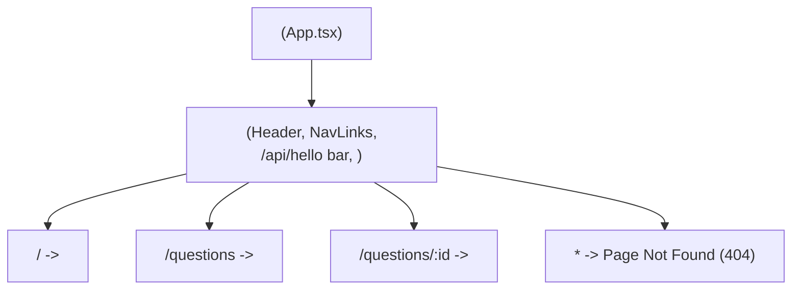

# Routing & Question Detail (Milestone 4)

**Router Config:** [frontend/src/App.tsx](../frontend/src/App.tsx)
**Shared Layout:** [frontend/src/components/Layout.tsx](../frontend/src/components/Layout.tsx)
**Pages:** [QuestionsPage.tsx](../frontend/src/pages/QuestionsPage.tsx), [QuestionDetailPage.tsx](../frontend/src/pages/QuestionDetailPage.tsx)
**Hook:** [frontend/src/hooks/useQuestion.ts](../frontend/src/hooks/useQuestion.ts)

Adds client-side routing with `react-router-dom` so `/questions` shows the filterable question list and `/questions/:id` shows a dedicated detail view for one question (or a friendly 404 screen when the ID doesn't exist).

---

## Route Map & Layout Hierarchy

---

## Key React Router Concepts Demonstrated

| Concept | File | How it works |
|---------|------|--------------|
| `BrowserRouter`, `Routes`, `Route`, `Navigate` | [App.tsx](../frontend/src/App.tsx) | Uses the browser's History API (`pushState`) to match the URL path and render the corresponding page without a full browser reload. |
| Shared Layout & `<Outlet />` | [Layout.tsx](../frontend/src/components/Layout.tsx) | Keeps the header, navigation links, and `/api/hello` greeting bar mounted while swapping child pages inside `<Outlet />`. |
| `<Link>` & `<NavLink>` | `Layout.tsx`, `QuestionCard.tsx`, `QuestionDetailPage.tsx` | Performs client-side navigation instead of `<a href="...">` (which would trigger a full document reload). `<NavLink>` automatically adds an `.active` class when its route matches. |
| `useParams()` | [QuestionDetailPage.tsx](../frontend/src/pages/QuestionDetailPage.tsx) | Reads `:id` from `/questions/:id` and passes it to `useQuestion(id)`. |
| `useNavigate()` | [QuestionDetailPage.tsx](../frontend/src/pages/QuestionDetailPage.tsx) | Programmatically navigates to `/questions/${numericId - 1}` and `/questions/${numericId + 1}` on the Prev/Next buttons. |
| `useSearchParams()` | [QuestionsPage.tsx](../frontend/src/pages/QuestionsPage.tsx) | Stores the active domain filter in `?domain=...` so filters can be bookmarked and survive Back/Forward navigation. |
| 404 Handling | [useQuestion.ts](../frontend/src/hooks/useQuestion.ts), `QuestionDetailPage.tsx` | Detects `res.status === 404` from `GET /api/questions/{id}` and renders a friendly "Question not found (404)" state with a link back to `/questions`. |

---

## Why Refreshing `/questions/1` Works in Dev (and What Production Needs)

- **In development (`npm run dev`):** Vite's dev server is configured as a Single-Page Application (SPA) server by default — any non-`/api` URL (such as `/questions/1`) returns `index.html`, and then React Router reads `window.location.pathname` (`/questions/1`) and renders `<QuestionDetailPage />`.
- **In production (Milestone 9):** When Spring Boot serves the static production bundle from `src/main/resources/static`, a browser refresh on `/questions/1` asks Spring Boot for `/questions/1`, which would return a server 404 unless Spring Boot is configured to forward non-API client routes back to `index.html`.

